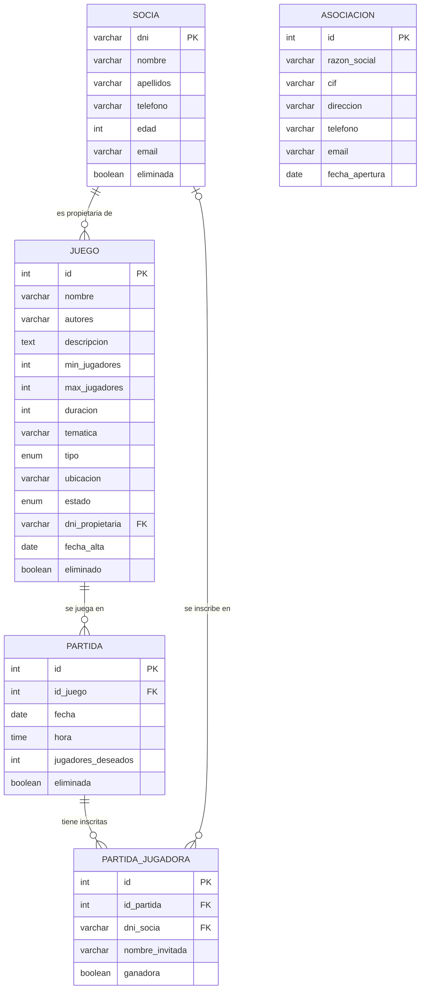

**Repositorio:** https://github.com/heerreeraa/ProyectoUd2

# 1. Introducción

Hemos desarrollado una aplicación de consola en Java para gestionar la asociación de juegos de mesa *Mahai Jokoak* de Vitoria-Gasteiz: sus socias, sus juegos y las partidas que se organizan. La aplicación sigue una arquitectura cliente/servidor: los datos están en un servidor MariaDB (en un contenedor Docker, puerto 3306) y la aplicación se conecta a él mediante **JDBC puro**, sin ningún ORM.

Tecnologías utilizadas:

| Herramienta | Uso |
|---|---|
| Java 17 + Maven | Lenguaje y gestión de dependencias |
| IntelliJ IDEA | Entorno de desarrollo |
| MariaDB 11.4 en Docker | Servidor de base de datos |
| MariaDB Connector/J | Driver JDBC |
| XStream | Exportación a XML (la misma librería que en la UD1) |
| Gson | Exportación a JSON |
| JUnit 5 | Tests |
| Git y GitHub | Control de versiones y trabajo en pareja |

# 2. Puesta en marcha y requisitos

## 2.1. Requisitos

- **Git**, para descargar el proyecto.
- **Docker Desktop**, donde se ejecuta el servidor MariaDB.
- **Java 17** (JDK).
- **IntelliJ IDEA** (vale la edición Community).

Maven no hace falta instalarlo: viene incluido en IntelliJ y el proyecto trae el *Maven Wrapper* (`mvnw` y `mvnw.cmd`), que lo descarga solo.

## 2.2. Descargar el proyecto

```bash
git clone https://github.com/heerreeraa/ProyectoUd2.git
```

O desde IntelliJ: *File → New → Project from Version Control* y pegar la misma URL.

## 2.3. Arrancar la base de datos

Con Docker Desktop abierto, en la carpeta del proyecto:

```bash
docker compose up -d
```

La primera vez se crea el contenedor `mariadb-asociacion` (puerto **3306**, usuario `root`, contraseña `root`), que ejecuta automáticamente `sql/bbdd.sql`: crea la base de datos `asociacion_juegos` con sus tablas y los datos de prueba (6 socias, 8 juegos y 5 partidas).

Si aparece el error *"port is already allocated"*, hay otro MySQL o MariaDB en el puerto 3306: hay que pararlo (`docker stop <nombre>`) y repetir el comando.

## 2.4. Abrir y ejecutar en IntelliJ

1. *File → Open* y elegir la carpeta del proyecto. Si aparece *Load Maven project*, pulsar **Load**.
2. En *File → Project Structure → Project → SDK* elegir un **JDK 17**.
3. Abrir `src/main/java/org/example/App.java` y pulsar el botón verde ▶.

## 2.5. Arranque automático

Los scripts `arrancar.sh` (macOS/Linux) y `arrancar.bat` (Windows) hacen todo lo anterior de una vez: comprueban que Docker está abierto, levantan la base de datos, esperan a que esté lista y arrancan la aplicación con `mvnw`.

## 2.6. Primer inicio de sesión

La primera vez, la aplicación pide crear el **usuario administrador**. Los usuarios se guardan en `datos/usuarios.dat` y las sesiones en `datos/sesiones.log`. Si se olvida la contraseña, basta con borrar `datos/usuarios.dat` y crear de nuevo el administrador.

## 2.7. Servidor en otro equipo

Los datos de conexión están en `config.properties` (`host`, `puerto`, `bbdd`, `usuario`, `password`). Para conectarse a un servidor de otro equipo de la red solo hay que cambiar `host` por su IP, sin recompilar.

## 2.8. Otros comandos útiles

| Para… | Comando |
|---|---|
| Ejecutar los tests (con Docker arrancado) | `./mvnw test` o, en IntelliJ, clic derecho en `src/test/java` → *Run 'All Tests'* |
| Volver a los datos de prueba iniciales | `docker compose down -v` y después `docker compose up -d` |

Los ficheros exportados se guardan en la carpeta `exportaciones/`.

# 3. Principales características

Al arrancar, la aplicación comprueba la conexión con la base de datos y pide iniciar sesión. Después muestra el menú principal con los datos de la asociación (razón social, CIF, dirección, contacto y fecha de apertura) y el usuario conectado.

| Menú | Funciones |
|---|---|
| **1. Socias** | Listar (activas o todas), ficha de una socia con **sus juegos y sus partidas (día y hora)**, alta, modificación, baja lógica o física, reactivar, exportar a XML/JSON y buscar |
| **2. Juegos** | Listar, ver un juego, alta, modificación, cambiar estado (disponible, prestado, en reparación), baja lógica o física, reactivar, exportar y buscar |
| **3. Partidas** | Listar con plazas libres, ver una partida con sus jugadoras, alta, modificación, **apuntar socias o invitadas**, quitar jugadoras, marcar ganadoras, baja lógica o física, reactivar, exportar y buscar |
| **4. Asociación** | Ver y modificar los datos de la asociación |
| **5. Metadatos** | Datos de la BBDD (SGBD, driver, URL, usuario), tablas con su clave primaria y columnas, columnas de una tabla (tipo, tamaño, si admite nulos, autoincremental, valor por defecto) y exportación a XML/JSON |
| **6. Usuarios** | Crear usuarios, cambiar la contraseña y ver el registro de sesiones |
| **7. Estadísticas** | Histórico de una socia y estadísticas de la asociación en un periodo, exportables |

**Reglas que comprueba la aplicación:**

- Los DNI y NIE se validan con su letra de control; también se validan email, teléfono, CIF, fechas y horas.
- Una partida solo se puede crear con un juego activo que no esté en reparación, y el número de jugadoras deseadas tiene que estar dentro del rango del juego.
- No se puede apuntar a nadie a una partida ya jugada, dada de baja o sin plazas libres, ni apuntar dos veces a la misma socia.
- Al cambiar el juego de una partida, no se permite si ya hay más jugadoras apuntadas que el máximo del nuevo juego.
- Las ganadoras solo se pueden marcar en partidas ya jugadas.
- El juego de una socia solo puede pertenecer a una socia activa.

**Control de errores.** Ninguna excepción llega al usuario sin controlar:

- Todo lo que se teclea pasa por la clase `Teclado`, que vuelve a preguntar si el dato no es válido (letras donde va un número, fechas imposibles…).
- Los errores de la base de datos se traducen a mensajes en español con `MensajesError` (clave duplicada, registro con datos relacionados, conexión perdida…).
- Si el servidor no está arrancado, la aplicación lo dice y termina.
- `App` tiene un `try/catch` general como red de seguridad.

## 3.1. Estructura del proyecto

| Paquete | Contenido |
|---|---|
| `models` | `Socia`, `Juego`, `Partida`, `Inscripcion` y `Asociacion` |
| `dao` | Interfaces DAO y sus implementaciones con JDBC |
| `menu` | Un menú por cada apartado y `MenuExportar` |
| `utils` | `ConexionBD`, `Teclado`, `Validador` y `MensajesError` |
| `export` | `Exportador` (XML y JSON) |
| `metadatos` | Lectura de los metadatos con `DatabaseMetaData` |
| `seguridad` | `Usuario` y `GestorUsuarios` (login y sesiones) |
| `estadisticas` | Consultas y clases del histórico y de las estadísticas |

Además: `sql/bbdd.sql` (creación de la base de datos y datos de prueba), `docker-compose.yml`, `config.properties`, los scripts de arranque y los tests en `src/test/java`.

# 4. Patrones de diseño

## 4.1. Singleton: `ConexionBD`

Toda la aplicación comparte **una única conexión** con la base de datos. El constructor de `ConexionBD` es privado, así que nadie puede crear otra instancia con `new`; la única forma de obtenerla es `ConexionBD.getInstance()`, que la crea la primera vez y después devuelve siempre la misma. Si la conexión se ha cerrado, crea una nueva.

Lo hemos elegido porque abrir una conexión es costoso y no tiene sentido abrir una por cada consulta en una aplicación de un solo usuario. La conexión se cierra una sola vez, al salir de la aplicación (`ConexionBD.cerrar()`).

## 4.2. DAO (*Data Access Object*)

Cada tabla tiene una **interfaz** (`SociaDao`, `JuegoDao`, `PartidaDao`, `AsociacionDao`) con las operaciones disponibles y una **implementación** (`SociaDaoImpl`…) con el SQL. Los DAO son las únicas clases que hablan con la base de datos: los menús no tienen ni una línea de SQL.

Así está separado el **qué** (la interfaz) del **cómo** (la implementación con JDBC). Si cambiáramos de SGBD o de forma de acceder a los datos, solo habría que cambiar la implementación. Los menús guardan el DAO en una variable del tipo de la interfaz (`SociaDao sociaDao = new SociaDaoImpl()`).

## 4.3. Separación en capas

El código está organizado en tres capas, parecido a un MVC sencillo:

- **Modelo** (`models`): clases que solo guardan datos, con atributos privados, getters y setters.
- **Acceso a datos** (`dao`): el SQL.
- **Presentación** (`menu`): lo que ve y teclea el usuario.

## 4.4. Clases de utilidad

`Teclado`, `Validador`, `MensajesError` y `Exportador` solo tienen métodos `static`: no guardan estado y se usan desde cualquier sitio sin crear objetos. Así la lectura de teclado, las validaciones, los mensajes de error y la exportación se escriben una sola vez.

# 5. Decisiones tomadas durante el desarrollo

**Los DAO lanzan `SQLException` y los menús la capturan.** Así cada menú puede mostrar el mensaje adecuado según lo que estaba haciendo. Por ejemplo, al borrar una socia, el error 1451 (tiene datos relacionados) no se muestra como un error: se ofrece hacer la baja lógica.

**Siempre `PreparedStatement` con `?`.** Nunca se concatenan los valores en el SQL, así que no hay riesgo de inyección SQL. En las búsquedas, la consulta se construye añadiendo un `and ... ?` por cada criterio rellenado y los valores se guardan en una lista que luego rellena los `?` en orden.

**Bajas lógicas y físicas.** El enunciado deja elegir; hemos hecho las dos. La baja lógica marca el registro como eliminado y conserva su historial (necesario para las estadísticas); se puede deshacer. La baja física solo se permite si no rompe la integridad referencial: es la propia base de datos la que lo impide con las claves foráneas, y la aplicación lo traduce a un mensaje.

**Las plazas libres no se guardan.** Se calculan restando las inscritas a las deseadas. Si se guardaran, habría que actualizarlas en cada inscripción y podrían quedar mal.

**Fechas y horas como `String` en los modelos.** Se validan al teclearlas con `LocalDate.parse` y `LocalTime.parse`, pero en los objetos se guardan como texto (`"2026-10-24"`, `"18:00"`). Así XStream y Gson las exportan directamente, sin tener que programar adaptadores para `LocalDate`, y MariaDB las acepta tal cual.

**Gson para JSON y XStream para XML.** XStream ya lo conocíamos de la UD1. Para JSON elegimos Gson porque con una línea (`new GsonBuilder().setPrettyPrinting().create().toJson(datos)`) convierte cualquier lista u objeto. Un único `Exportador` sirve para socias, juegos, partidas, metadatos y estadísticas; los alias de XStream cambian el nombre completo de las clases por etiquetas cortas (`<juego>`).

**`config.properties` para la conexión.** Para que la aplicación pueda conectarse a un servidor en otro equipo sin tocar el código, cumpliendo la arquitectura cliente/servidor.

**Contraseñas con SHA-256 y sal.** La contraseña nunca se guarda: se guarda el hash de la sal más la contraseña. La sal es aleatoria y distinta para cada usuario, así que dos usuarios con la misma contraseña tienen hashes distintos. Los usuarios se guardan como un `ArrayList<Usuario>` serializado en un fichero binario, como pide la mejora.

**Docker y Maven Wrapper.** Con `docker-compose.yml` cualquiera tiene la misma base de datos con los mismos datos de prueba en un minuto, y con `mvnw` no hace falta instalar Maven.

**Trabajo en pareja con Git.** Nos repartimos el trabajo por paquetes para no tocar los mismos ficheros a la vez y evitar conflictos, y acordamos el mismo estilo de código (el visto en clase: `close()` a mano, comentarios en español, sin streams ni lambdas). Las decisiones sobre el modelo de datos se explican en el apartado siguiente.

# 6. Modelo entidad-relación



| Relación | Cardinalidad | Implementación |
|---|---|---|
| Socia – Juego (propietaria) | 1 : N opcional | `juego.dni_propietaria` → `socia.dni`, admite NULL |
| Juego – Partida | 1 : N | `partida.id_juego` → `juego.id` |
| Partida – Socia (jugadoras) | N : M | Tabla intermedia `partida_jugadora` |
| Asociación | — | Tabla independiente con una sola fila |

**Socia con el DNI como clave primaria.** El DNI, NIE o pasaporte ya identifica a cada socia, así que no hace falta un id artificial. Por ser la clave primaria, la aplicación no permite modificarlo.

**Propietaria del juego opcional.** Un juego puede ser de la asociación o de una socia. En vez de otra tabla, `dni_propietaria` admite NULL: NULL significa que es de la asociación.

**Partida – Socia es N:M.** Una partida tiene varias jugadoras y una socia juega muchas partidas, así que hace falta la tabla `partida_jugadora`, que además guarda:

- **Las invitadas.** No son socias, así que `dni_socia` queda a NULL y se guarda su nombre en `nombre_invitada`. El `CHECK chk_socia_o_invitada` obliga a que tenga uno de los dos.
- **Las ganadoras.** El campo `ganadora` va en la inscripción y no en la partida porque puede haber varias (por ejemplo, en un juego cooperativo).
- **`UNIQUE (id_partida, dni_socia)`.** Impide apuntar dos veces a la misma socia. Como MariaDB permite varios NULL en un UNIQUE, sí se pueden apuntar varias invitadas.

**Asociación como tabla aparte.** Guarda los datos que se muestran y modifican desde el menú. Solo tiene una fila y no se relaciona con las demás porque toda la base de datos es de una única asociación.

**Integridad referencial.** Las claves foráneas no tienen `ON DELETE CASCADE`, así que MariaDB impide borrar una socia con juegos o inscripciones, o un juego con partidas. La excepción es `partida_jugadora → partida`: al borrar una partida se borran sus inscripciones, porque no tiene sentido conservarlas.

**Restricciones `CHECK` y `ENUM`.** La base de datos también valida los datos aunque la aplicación ya lo haga: mínimo de jugadoras ≥ 1 y menor o igual que el máximo, edad entre 0 y 120, y tipo y estado del juego limitados a sus valores válidos.

**Sin `ON UPDATE CASCADE` en las claves de socia.** MariaDB no permite usar en un `CHECK` una columna con una clave foránea `ON UPDATE CASCADE` (es el caso de `dni_socia`), y como el DNI no se modifica no hace falta.

# 7. Mejoras implementadas

| Bloque | Mejora | Cómo probarla |
|---|---|---|
| 1 · Despliegue | `docker-compose.yml`, `arrancar.sh` / `arrancar.bat` y Maven Wrapper: ponen en marcha base de datos y aplicación con un solo comando | `./arrancar.sh` |
| 2 · Calidad | 27 tests JUnit 5: validaciones y DAO de socias, juegos y partidas contra la base de datos real. Cada test crea sus datos con `@BeforeEach` y los borra con `@AfterEach`; también comprueban que la BBDD rechaza lo que debe (clave duplicada, borrar con datos relacionados, `CHECK`) | `./mvnw test` |
| 3 · Búsquedas | Juegos por nombre, temática, tipo, número de jugadoras, duración máxima y estado; socias por nombre, apellidos y rango de edad; partidas por juego, periodo y plazas libres. Los criterios se combinan | Opción *Buscar* de cada menú |
| 4 · Estadísticas | Histórico de una socia en un periodo (partidas, victorias, % de victorias, juego más jugado) y estadísticas de la asociación (partidas, media de jugadoras, ocupación, invitadas, juegos más jugados, socias con más partidas y victorias, juegos por estado, tipo y propietaria). Exportables a XML y JSON | Menú *7. Estadísticas* |
| 5 · Seguridad | Login con usuarios en fichero binario (contraseñas con SHA-256 y sal, 3 intentos) y registro de entradas, salidas y fallos en un fichero de texto | Al arrancar y menú *6. Usuarios* |

# 8. Pruebas realizadas

Además de los tests automáticos, hemos probado a mano a romper la aplicación siguiendo una lista de pruebas por cada menú (opciones, socias, juegos, partidas, búsquedas, estadísticas, metadatos, login, servidor caído y exportaciones). En todos los casos la aplicación muestra un mensaje y sigue funcionando:

| Prueba | Resultado |
|---|---|
| Letras, números negativos o vacío donde se espera un número | Vuelve a preguntar |
| Fechas y horas imposibles (`2026-02-30`, `25:00`) | Vuelve a preguntar |
| DNI con la letra mal, email sin `@`, teléfono con letras, edad 200 | Vuelve a preguntar con un ejemplo válido |
| Números de juego, partida o DNI que no existen | Avisa de que no existe |
| Borrar una socia con partidas o un juego con partidas | Avisa y ofrece la baja lógica |
| Mínimo de jugadoras mayor que el máximo | No lo deja guardar |
| Apuntarse a una partida llena, ya jugada o dos veces | Avisa y no lo hace |
| Textos con comillas en las búsquedas (`O'Brien`) | Funciona: los valores van en `PreparedStatement` |
| Fichero `usuarios.dat` dañado | Avisa y explica cómo recuperarlo |
| Apagar el servidor con la aplicación abierta | Muestra "Se ha perdido la conexión…" en cada opción. Al volver a arrancar el servidor, la aplicación se reconecta sola |
| Estadísticas de un periodo sin partidas o de un DNI que no existe | Medias a 0 (sin dividir entre cero), "Ninguno" en los rankings, o aviso de que la socia no existe |
| Exportar a XML y JSON todos los listados, metadatos y estadísticas | Ficheros correctos en `exportaciones/` |

Las pruebas nos sirvieron para mejorar dos cosas:

- **Reconexión.** Al principio, si el servidor se caía y volvía, la aplicación seguía sin conexión: `ConexionBD` solo comprobaba si la conexión estaba cerrada, y una conexión cortada por el servidor no aparece como cerrada. Ahora comprueba `isValid(2)`, que pregunta al servidor.
- **Presentación de las estadísticas.** Separamos los datos del periodo de los datos actuales (socias activas y juegos), cambiamos `[]` por "Ninguno" cuando no hay datos y corregimos el singular y plural ("1 partida").

# 9. Actas de seguimiento

## Acta 1 · 19/10/2026 · Inicio y reparto

**Asistentes:** Jon Herrera y Joseba Fernández.

**Temas tratados:**

- Lectura del enunciado y objetivo: los mínimos más las mejoras de los bloques 1 a 5.
- Diseño del modelo E/R (tablas, relaciones, bajas lógicas, invitadas en la tabla intermedia).
- Reparto por paquetes para no pisarnos en Git:
  - **Jon:** base del proyecto (Maven, Docker, SQL, conexión, modelos), DAOs y menús de socias, juegos, partidas y asociación, búsquedas, tests y scripts de arranque.
  - **Joseba:** exportación a XML/JSON, metadatos, login y sesiones, y estadísticas.
- Acordamos el estilo de código común.

**Avances:** proyecto Maven, `docker-compose.yml`, script SQL con datos de prueba, conexión Singleton, clase `Teclado` y modelos subidos al repositorio.

**Problemas:** al cambiar los mensajes de commits ya subidos se duplicaron en el historial. Acordamos no modificar nunca commits subidos y hacer siempre `git pull` antes de empezar.

**Objetivos para la siguiente reunión:** CRUD de socias, juegos y partidas (Jon) y exportador y metadatos (Joseba).

## Acta 2 · 19/10/2026 · Integración

**Asistentes:** Jon Herrera y Joseba Fernández.

**Avances:**

- **Jon:** DAOs y menús de socias, juegos, partidas y asociación, validaciones y traducción de errores.
- **Joseba:** exportador XML/JSON, metadatos, login con registro de sesiones y primera parte de las estadísticas.

**Revisión conjunta del código:**

- La raíz del XML salía como `<list>`: XStream trata los `ArrayList` como `List`, y el alias hay que ponerlo sobre `List.class`.
- En MariaDB el esquema de las tablas viene en `TABLE_CAT` y no en `TABLE_SCHEM`.
- Algunos archivos nuevos no se habían añadido al commit y se había subido una clase de prueba. La añadimos al `.gitignore` y acordamos revisar `git status` antes de cada commit.
- Simplificamos el código que se había complicado de más, para que siga el estilo común.

**Integración:** login al arrancar y menús de metadatos, usuarios y estadísticas en el menú principal.

**Objetivos:** búsquedas, tests y scripts de arranque (Jon); probar a romper la aplicación (Joseba).

## Acta 3 · 20/10/2026 · Cierre

**Asistentes:** Jon Herrera y Joseba Fernández.

**Avances:**

- Búsquedas avanzadas, 27 tests JUnit y scripts de arranque terminados.
- Modelo E/R documentado.
- Manual de puesta en marcha y memoria.
- **Pruebas para romper la aplicación (Joseba):** todas las de la lista funcionaron bien, sin ninguna excepción sin controlar. Solo hubo que mejorar la presentación de las estadísticas cuando no hay partidas en el periodo.
- **Mejora encontrada al probar con el servidor apagado (Jon):** la aplicación ahora se reconecta sola cuando el servidor vuelve a arrancar.

**Objetivos:** entregar el proyecto y preparar la defensa explicando cada uno el código del otro.
