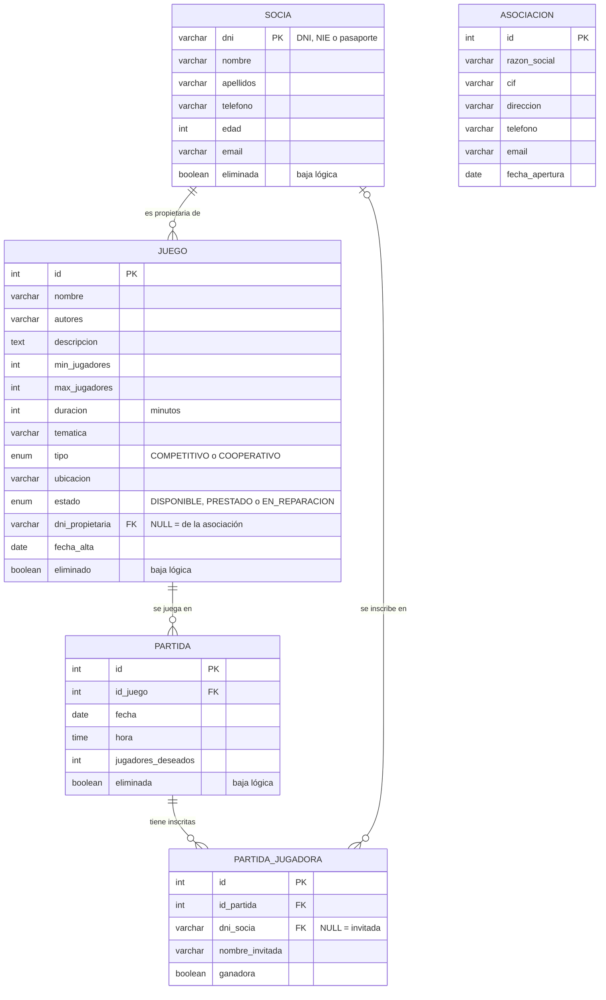

# Modelo entidad-relación

Base de datos `asociacion_juegos` (MariaDB). El script completo está en [`sql/bbdd.sql`](../sql/bbdd.sql).

## Diagrama

## Relaciones

| Relación | Cardinalidad | Cómo se implementa |
|---|---|---|
| Socia – Juego (propietaria) | 1 : N opcional | `juego.dni_propietaria` → `socia.dni`, admite NULL |
| Juego – Partida | 1 : N | `partida.id_juego` → `juego.id`, obligatorio |
| Partida – Socia (jugadoras) | N : M | Tabla intermedia `partida_jugadora` |
| Asociación | — | Tabla independiente con una sola fila |

## Decisiones y justificación

**Socia con el DNI como clave primaria.** El DNI, NIE o pasaporte ya identifica a cada socia y no se repite, así que no hace falta un id artificial. Como es la clave primaria, la aplicación no deja modificarlo: para cambiarlo habría que dar de baja la socia y crearla de nuevo.

**Propietaria del juego opcional.** El enunciado dice que un juego puede ser de la asociación o de una socia. En vez de crear otra tabla, `dni_propietaria` admite NULL: si es NULL, el juego es de la asociación; si tiene un DNI, es de esa socia.

**Partida – Socia es N:M con tabla intermedia.** Una partida tiene varias jugadoras y una socia juega muchas partidas, así que hace falta la tabla `partida_jugadora`. En ella guardamos también:
- **Las invitadas**: el enunciado dice que en una partida juegan socias o invitadas. Las invitadas no son socias, así que no tienen fila en `socia`. En ese caso `dni_socia` es NULL y se guarda su nombre en `nombre_invitada`. El `CHECK chk_socia_o_invitada` obliga a que tenga uno de los dos.
- **Las ganadoras**: el campo `ganadora` está en la inscripción y no en la partida, porque puede haber varias ganadoras (por ejemplo, en un juego cooperativo ganan todas).
- **El `UNIQUE (id_partida, dni_socia)`** impide apuntar dos veces a la misma socia en la misma partida. Como MariaDB permite varios NULL en un UNIQUE, sí se pueden apuntar varias invitadas.

**Las plazas libres no se guardan.** Se calculan como `jugadores_deseados - número de inscritas` (método `getPlazasLibres()` de `Partida`). Si se guardaran, habría que actualizarlas cada vez que alguien se apunta o se borra, y podrían quedar desincronizadas.

**Asociación como tabla aparte.** Guarda los datos que se muestran en el menú principal y se pueden modificar. Solo tiene una fila (id = 1). No está relacionada con las demás porque toda la base de datos es de una única asociación.

**Bajas lógicas y físicas.** Socias, juegos y partidas tienen un campo `eliminada` / `eliminado`:
- **Baja lógica**: se marca a TRUE. El registro deja de salir en los listados pero se conserva su historial (partidas jugadas, estadísticas). Se puede reactivar.
- **Baja física**: `DELETE`. Las claves foráneas no tienen `ON DELETE CASCADE` (salvo la de partida → inscripciones), así que MariaDB **impide** borrar una socia con juegos o inscripciones, o un juego con partidas (error 1451). La aplicación captura ese error y ofrece hacer la baja lógica. Así se respeta siempre la integridad referencial.
- **Al borrar una partida**, sus inscripciones se borran solas por el `ON DELETE CASCADE`. No tiene sentido conservar inscripciones de una partida que ya no existe.

**Restricciones `CHECK`.** La base de datos también valida los datos, aunque la aplicación ya los compruebe antes:
- `chk_jugadores`: mínimo de jugadoras ≥ 1 y menor o igual que el máximo.
- `chk_edad`: edad entre 0 y 120.
- `chk_socia_o_invitada`: cada inscripción es de una socia o de una invitada.

**Por qué no hay `ON UPDATE CASCADE` en las claves de socia.** MariaDB no permite usar en un `CHECK` una columna que tenga una clave foránea con `ON UPDATE CASCADE` (le pasa a `dni_socia`). Como el DNI no se modifica desde la aplicación, no hace falta.

**Tipos ENUM para tipo y estado.** Solo admiten los valores válidos (`COMPETITIVO`/`COOPERATIVO` y `DISPONIBLE`/`PRESTADO`/`EN_REPARACION`), así que no se puede guardar un estado mal escrito.
